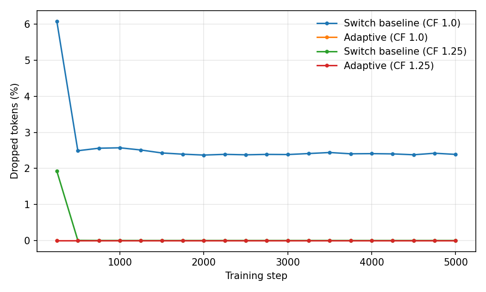
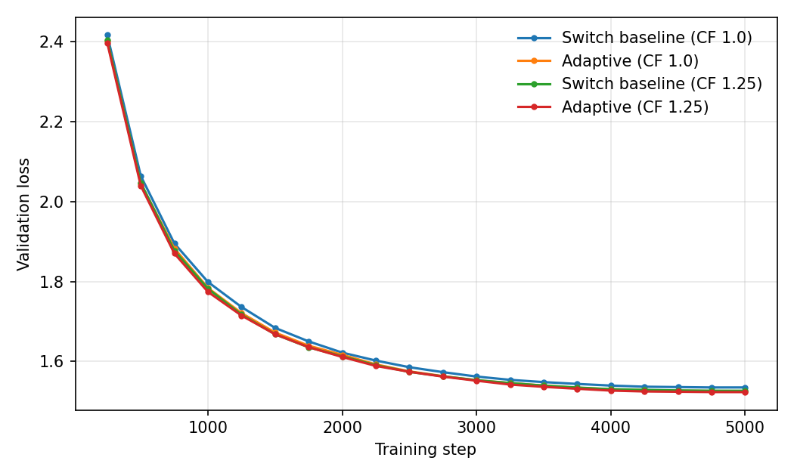

# Adaptive Switch MoE

A PyTorch implementation of the [Switch Transformer](https://arxiv.org/abs/2101.03961) Mixture-of-Experts layer, together with an **adaptive routing variant** that stops capacity-induced token dropping. The two are compared on character-level language modelling (Tiny Shakespeare), with multiple seeds and ablations.

<p align="center">
  
  
</p>

## Motivation

A Switch layer sends each token to a single expert (Top-1 routing), and each expert has a fixed capacity

$$C = \phi \cdot \frac{T}{E}$$

where $T$ is the number of tokens in the batch, $E$ the number of experts and $\phi$ the capacity factor. When the router overloads an expert, the extra tokens are **dropped**: they skip the FFN and pass through only on the residual connection. The usual fix is a larger $\phi$, which pads every expert and wastes compute. This project instead redistributes overflow tokens to experts that still have room.

## Method

`AdaptiveSwitchFFN` ([`moe/model.py`](moe/model.py)) keeps the standard router and changes what happens on overflow:

**1. Adaptive capacity.** Overloaded experts get a bounded amount of slack:

$$C_i = C + \min\left(k \cdot \max(0,\ n_i - T/E),\ C/2\right)$$

where $n_i$ is the number of tokens routed to expert $i$ (default $k = 0.2$).

**2. Importance-priority trimming.** If an expert still overflows, it keeps the tokens with the largest $\lVert x \rVert_2$ rather than a random subset, so the strongest activations are the last to be displaced.

**3. No-Token-Left-Behind (NTLB) reassignment.** Each overflow token, taken in priority order, is greedily moved to the expert with spare capacity that maximises

$$\text{score}(t, j) = \frac{p(t, j)}{1 + \text{load}_j}$$

which trades router confidence against load. The gate uses the probability of the expert that actually processes the token, so the router receives gradient for the reassignment. A token is dropped only when every expert is full.

**4. SimBal router regulariser.** This loss pushes the row-normalised router weights towards orthogonality to discourage expert collapse:

$$\mathcal{L}_{\text{simbal}} = \gamma \sum_{i \neq j} \left(\hat W \hat W^\top\right)_{ij}^2$$

It is added to the standard Switch load-balancing loss $\alpha E \sum_i f_i P_i$.

> **Design note.** An earlier version biased the router logits by a token-importance score, $l' = l + \lambda \tilde s$. Every expert's logit receives the same $\lambda \tilde s$, and softmax ignores a constant shift like that, so the bias **never changes the routing distribution**. Importance therefore affects only which tokens an overflowing expert keeps (step 2).

## Results

Setup: a 4-layer decoder-only character LM with $d_{model}=128$, 4 heads and 4 experts per layer (2.4M parameters). Each run uses 5,000 steps with batch 64 × context 128, AdamW and cosine LR. Validation is on a held-out contiguous 10% of Tiny Shakespeare, using the same 50 batches for every run. Numbers are **mean ± std over 3 seeds** at the final step.

| Model | Val loss ↓ | Dropped tokens (train) | Tokens reassigned |
|---|---|---|---|
| Switch baseline, CF 1.0 | 1.5345 ± 0.0050 | 2.39 ± 0.14% | — |
| **Adaptive, CF 1.0** | **1.5255 ± 0.0035** | **0.00%** | 2.51 ± 0.55% |
| Switch baseline, CF 1.25 | 1.5262 ± 0.0078 | 0.00% | — |
| Adaptive, CF 1.25 | 1.5229 ± 0.0002 | 0.00% | 0.00% |

**Ablations** (adaptive model at CF 1.0, one component removed at a time):

| Variant | Val loss ↓ | Dropped tokens (train) |
|---|---|---|
| Full adaptive | 1.5255 ± 0.0035 | 0.00% |
| without NTLB reassignment | 1.5268 ± 0.0113 | 1.73 ± 0.53% |
| without importance-priority trimming | 1.5372 ± 0.0097 | 0.00% |
| without SimBal | 1.5252 ± 0.0064 | 0.00% |

### Takeaways

- **The adaptive router removes token dropping at CF 1.0.** The baseline drops about 2.4% of tokens throughout training; adaptive capacity plus NTLB brings that to zero. Validation loss improves by about 0.009 nats, which matches the gain from raising the baseline's capacity factor to 1.25.
- **Once nothing is dropped, the gap disappears.** At CF 1.25 neither model drops tokens, and the remaining difference is within seed variance. The benefit comes from avoiding drops, not from better routing in general.
- **Importance-priority trimming matters most in the ablations.** Without it, validation loss is the worst of the adaptive variants. **SimBal shows no measurable effect** at this scale.
- **Cost.** The NTLB pass is a greedy loop on the CPU, so adaptive runs at CF 1.0 take about 1.6× the baseline's wall-clock time (≈350 s vs ≈225 s on an RTX 5080). A vectorised or fused-kernel version would be needed at scale.

Per-run metrics are in [`results/runs/`](results/runs) and the aggregate table in [`results/summary.md`](results/summary.md).

## Quick start

```bash
pip install -r requirements.txt

python -m pytest tests                  # sanity checks: causality, drop accounting, gradients
python train.py --moe baseline          # Switch baseline
python train.py --moe adaptive          # adaptive routing
```

Tiny Shakespeare is downloaded to `data/` on first run. Every component can be toggled from the command line (`--no-reassign`, `--no-importance-priority`, `--simbal-coef 0`, `--adaptive-k`, `--capacity-factor`, …); see `python train.py --help`.

To reproduce every number above (21 runs) and regenerate the tables and figures:

```bash
bash scripts/run_experiments.sh python 3   # <python executable> <parallel jobs>
```

## Project structure

```
moe/
  model.py          SwitchFFN, AdaptiveSwitchFFN, SwitchTransformerLM
  data.py           Tiny Shakespeare loader with a contiguous train/val split
train.py            training and evaluation entry point (CLI)
scripts/
  run_experiments.sh  all runs reported in this README
  summarize.py        aggregates runs into results/summary.md and figures
tests/              unit tests for routing, causality and gradients
results/            per-run metrics (CSV/JSON), summary table, figures
```

## Limitations and next steps

- Small scale only: a 2.4M-parameter character model and 4 experts. The effect on larger models and datasets (e.g. C4) is untested.
- Reassignment runs sequentially on the CPU; a vectorised GPU implementation is the obvious next step.
- Expert specialisation is not measured directly, so SimBal's intended effect on expert diversity remains to be evaluated.

## References

- W. Fedus, B. Zoph, N. Shazeer. *Switch Transformers: Scaling to Trillion Parameter Models with Simple and Efficient Sparsity.* JMLR, 2022. [arXiv:2101.03961](https://arxiv.org/abs/2101.03961)

## Author

**Ajay Singh** · [GitHub @Ajay-Singh-aj](https://github.com/Ajay-Singh-aj)

## License

Released under the [MIT License](LICENSE).
